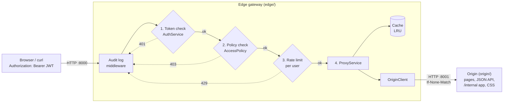

# Mini CDN + Zero-Trust Gateway

A tiny CDN edge server in Python/FastAPI that is also a **zero-trust access gateway**: every request must prove who it is (JWT), must be allowed by a default-deny policy, is rate limited per user, is written to an audit log, and only then may be served from cache or the origin. Comes with tests, a live dashboard and a fake "far away" website behind it.

> New here? **[ZERO_TRUST.md](ZERO_TRUST.md)** explains the zero-trust part in plain language (and how it maps to Akamai Enterprise Application Access). Turn it off with `ZERO_TRUST_ENABLED=false` to get the plain CDN.


## 1. The pitch

Mini CDN is two small web apps. The **origin** is a normal website (HTML pages, a JSON API, a CSS file) that is slow on purpose (+300 ms), like a server on the other side of the world. The **edge** is a caching reverse proxy that sits in front of it. Users talk only to the edge. The edge keeps copies of responses in memory and answers repeat requests itself in about 1 ms instead of about 300 ms. It follows the origin's `Cache-Control` rules, checks expired copies cheaply with `ETag` / `304 Not Modified`, rate-limits abusive clients, and lets an admin purge content. On top of that, the edge acts as an **identity-aware proxy**: it never trusts a request just because it reached it. It checks a signed token and a role-based policy on every request before anything (even cached content) is served. That is the same basic job an Akamai edge server does. Akamai runs this on hundreds of thousands of servers placed close to users, so content is served nearby, origins get less traffic, and attacks are stopped at the edge before they reach the origin.

## 2. Architecture



Plain text version:

```
client --> [token check] --> [policy check] --> [rate limit] --> [cache] --HIT--> response
              | 401             | 403              | 429           | MISS / stale
              v                 v                  v               v
                       audit log line (every request)          origin (+300 ms)
```

Layers: **routes** (HTTP in/out only) → **guards + service classes** (the logic) → nothing else. There is no database.

### Request flows

**Zero-trust checks** (run first on every proxied request, when `ZERO_TRUST_ENABLED=true`)
1. **Token check** (`authenticate`): no `Authorization: Bearer` header, a bad signature, or an expired token → `401`.
2. **Policy check** (`authorize`): the user's `role` claim is checked against `policy.json` for this path. Wrong role or no matching rule → `403`. This runs **before the cache**, so cached data is never handed to someone who isn't allowed to see it.
3. **Rate limit** (`enforce_rate_limit`): one token from *this user's* bucket (`user:alice`). Empty → `429`.
4. Only now does the request reach the cache / origin (flows below).
5. **Audit**: the middleware writes one line with user, role, decision (`ALLOWED` / `DENIED_401` / `DENIED_403` / `RATE_LIMITED`) and the reason.

**Cache miss** (first request for `/api/products`)
1. Request reaches the edge. The logging middleware starts a timer.
2. Zero-trust checks pass (above). With zero trust off, the rate limiter keys on the client IP instead.
3. `ProxyService` builds the key `GET /api/products?` and looks in the cache. Nothing there.
4. `OriginClient` fetches it from the origin (about 300 ms).
5. The origin says `Cache-Control: public, max-age=10` and `ETag: "1340…"`. Status is 200 and it is cacheable, so the edge stores it.
6. The edge replies with the body plus `X-Cache: MISS`, `Age: 0`.

**Cache hit** (same URL within 10 s)
1. Rate limit check, then cache lookup: entry found and its age (3 s) is below max-age (10 s), so it is fresh.
2. The edge replies straight from memory: `X-Cache: HIT`, `Age: 3`. The origin is never contacted. About 1–3 ms.

**Expired entry revalidated with 304** (same URL after 10 s)
1. Entry found but stale (age ≥ max-age). It has an ETag, so the edge asks the origin: `GET /api/products` with `If-None-Match: "1340…"`.
2. The content did not change, so the origin replies `304 Not Modified` with no body (tiny response).
3. The edge keeps its stored body, resets its clock (`stored_at = now`), and replies `X-Cache: REVALIDATED`, `Age: 0`.
4. If the content *had* changed, the origin would send `200` with the new body, and the edge would store it and reply `MISS`.

**Purge**
1. Admin calls `POST /admin/login` with username + password. The edge checks the password against a bcrypt hash and returns a JWT valid for 15 minutes.
2. Admin calls `POST /admin/purge` with `Authorization: Bearer <JWT>` and `{"path": "/api/products"}` (or `{}` for everything).
3. `require_admin` verifies the JWT signature and expiry (`401` if bad).
4. The cache deletes every entry for that path, including all query-string variants, and returns how many were removed. The next request is a `MISS`.

## 3. Design decisions and why

- **Reverse proxy.** Clients don't need to change anything: they call the edge as if it were the website. The origin stays simple and doesn't know a cache exists. This is exactly how a CDN is deployed: DNS points `www.shop.com` at the CDN, and the CDN points at the origin.
- **Cache key = method + path + query string** (`GET /api/products?category=books`). Different query strings can return different content, so they must be different entries. Including the method keeps the door open for caching `HEAD` later. Headers (cookies, language) are **not** in the key. That is a simplification. Real CDNs let you add them (the `Vary` header).
- **LRU eviction.** Memory is limited, so something must be thrown out. "Least recently used" keeps popular content and drops what nobody asked for lately, which fits web traffic where a few URLs get most requests. `OrderedDict` gives O(1) get, put and evict.
- **Stale entries are kept, not deleted.** An expired entry still has a body and an ETag. Keeping it lets us revalidate with a cheap 304 instead of downloading everything again.
- **ETag revalidation.** "Did it change?" costs a round trip but almost no bandwidth. For big files (images, video) that saves a lot. The origin's ETag is a hash of the content, so if the content is the same, the ETag is the same.
- **Token bucket for rate limiting.** It allows short bursts (a page loading 20 files at once) but limits the long-term rate. It needs only two numbers per client (tokens, last update), with no list of timestamps. It also tells us exactly how long to wait, which becomes `Retry-After`.
- **JWT for admin.** The password is checked once. After that the admin sends a signed token, and the edge verifies it with just the secret key: no session storage. In a real CDN with many edges, any edge could verify the token without asking a central server. Short expiry (15 min) limits the damage if a token leaks. The password is stored only as a bcrypt hash (slow on purpose, salted).
- **Dependency injection (`Depends`).** Routes ask for services (`get_cache`, `get_proxy_service`, …) instead of creating them. `create_app()` builds them once. Tests pass in a fake origin transport and a fake clock, or override any provider. No monkey-patching needed.
- **In-memory cache.** The simplest thing that works, and the fastest (no network hop). The cost: the cache is lost on restart and not shared. See weak spots.
- **App factory (`create_app`)** instead of a global `app`. Each test gets a fresh app with its own cache, so tests can't affect each other.
- **Injected clock.** Cache freshness and rate limiting read time from a `clock` function. Tests use a fake clock and "wait 11 seconds" instantly.
- **Only GET 200 responses are cached.** Errors (404, 500) are not cached so a temporary origin problem doesn't stick. POST etc. change data, so they must never be cached (the edge only proxies GET).
- **`no-store`, `private`, `no-cache`, missing or zero `max-age` → not cached.** A conservative choice: when in doubt, don't cache. (Real CDNs handle `no-cache` by always revalidating. I simplified it to "don't cache".)
- **`/admin/stats` is public, purge is protected.** Stats are read-only numbers that the dashboard polls. Purge changes state, so it needs a JWT. In production, stats would also be behind auth.
- **Login is rate limited too.** This slows down password guessing.
- **Origin down → 502 Bad Gateway.** The standard status for "the server behind me failed".
- **Zero trust: verify every request at the edge.** Being "inside the network" grants nothing. Identity (JWT) + policy are checked on every single request, not once per session. See [ZERO_TRUST.md](ZERO_TRUST.md).
- **Policy before cache.** The cache key does not include the user, so the access check must happen before the cache lookup. Otherwise a cached `/api` response could leak to an intern.
- **Default deny.** A path that no rule mentions is blocked, even for admin. Forgetting a rule fails safe (403) instead of exposing an app.
- **Exact vs prefix rules.** `"/"` matches only the home page, `"/api/*"` matches everything under `/api/`. The most specific (longest) rule wins. (An earlier version treated `"/"` as a prefix, so it matched everything and broke default deny. The live demo caught it and a test now covers it.)
- **Path traversal blocked.** `/api/../internal/reports` (or `%2e%2e`) is rejected with 403. Otherwise someone could pass the `/api/*` check and reach the admin-only app.
- **Rate limit per user, not per IP.** Many users can share one office IP (NAT). One user can use many IPs. Keying on the verified `sub` is fairer and harder to dodge. Anonymous calls (login) still use the IP.
- **One login for everyone.** `/auth/login` (and the old `/admin/login`) use the same `AuthService`. The JWT carries `sub` + `role`. Purge simply requires `role == "admin"`.
- **Feature flag.** `ZERO_TRUST_ENABLED=false` turns the guards off, so the original CDN demo and tests still work unchanged.
- **Python 3.11 target.** CI runs on 3.11. Local checks were run on 3.13.

## 4. HTTP concepts used

| Concept | Where | What it does here |
|---|---|---|
| `Cache-Control: max-age=N` | origin sets it, edge reads it | Pages 30 s, API 10 s. The edge serves its copy for N seconds without asking the origin. |
| `Cache-Control: no-store` | `/api/time` | "Never keep a copy." Edge always forwards to origin (`X-Cache: MISS` every time). |
| `ETag` | every origin page/API/CSS | A fingerprint (hash) of the body. Same content → same ETag. |
| `If-None-Match` | edge → origin when an entry is stale | "I have version X. Only send the body if it's different." |
| `304 Not Modified` | origin → edge | "Your copy is still good." No body, so it's tiny. The edge reuses its copy. |
| `429 Too Many Requests` | edge, rate limiter | The client used up its token bucket. |
| `Retry-After` | sent with 429 | Seconds until the client gets a new token (rounded up). |
| `Age` | edge → client | Seconds since the edge got this content from the origin. A browser subtracts it from max-age to know how much freshness is left. |
| `X-Cache` | edge → client | Not standard but common (Akamai has similar debug headers): `HIT`, `MISS` or `REVALIDATED`. |
| `Authorization: Bearer <JWT>` | every proxied request (zero trust) | Proves who the user is. The JWT has `sub`, `role`, `exp`, signed with HS256. |
| `401` + `WWW-Authenticate: Bearer` | missing/invalid/expired token | "Who are you? Authenticate first." |
| `403 Forbidden` | policy says no, or non-admin purge | "I know who you are, and you may not do this." |
| `502 Bad Gateway` | origin unreachable | The proxy's upstream failed. |
| **Cache busting** | `/static/styles.<hash>.css` | The CSS file name contains a hash of its content and is cached for 1 year (`immutable`). When the CSS changes, the hash and URL change, so every cache fetches the new file automatically. No purge needed. An old or unknown hash gives 404. |

## 5. Weak spots and how I'd improve them

| Weak spot | Improvement |
|---|---|
| Cache is in memory: lost on restart, not shared between edge processes. | Shared cache like **Redis**, or a two-tier cache (small in-memory L1 + Redis/disk L2). |
| One edge in one place. | **Many edges** in many regions. **DNS** (geo-aware) or **anycast** routes each user to the nearest healthy edge. A mid-tier "parent" cache between edges and origin cuts origin load further. |
| No HTTPS. | **Terminate TLS at the edge** (certificates, HTTP/2 or HTTP/3), and use TLS from edge to origin too. |
| **Thundering herd**: when a popular entry expires, 1,000 simultaneous requests all go to the origin. | **Request coalescing**: the first request fetches, the others wait for its result (an `asyncio` lock or future per key). Also `stale-while-revalidate`: serve the stale copy while one background request refreshes it. |
| JWT can't be revoked before it expires. | Keep expiry short (done: 15 min). Add a **denylist** of revoked token IDs (`jti`), or use refresh tokens. |
| Rate limiter memory grows with every new IP, and limits are per edge process. | Drop idle buckets (TTL cleanup). Use Redis for shared counters across edges. |
| Client IP is `request.client.host`. Behind a load balancer every user looks the same. | Trust `X-Forwarded-For` only from known proxies. |
| Cache key ignores headers (`Vary`, cookies, `Accept-Encoding`). | Support `Vary` and normalise the key (sort query params, ignore tracking params like `utm_*`). |
| Whole bodies are held in memory, limit is by number of entries, not bytes. | Limit by total bytes. Stream large files instead of buffering them. Don't cache bodies above a size limit. |
| Edge doesn't answer the browser's own `If-None-Match` with 304. | Compare the client's `If-None-Match` with the cached ETag and send 304 directly. |
| Origin down = 502 even if we have a stale copy. | `stale-if-error`: serve the stale copy when the origin fails. |
| No compression. | gzip/brotli at the edge, keyed on `Accept-Encoding`. |
| Stats are per process, and reset on restart. | Export metrics to Prometheus/Grafana. |
| Admin purge is by exact path only. | Purge by prefix, wildcard or **cache tags** (like Akamai's Fast Purge by tag). |
| One shared HS256 secret signs and verifies tokens: every edge holding it could also forge tokens. | **Asymmetric keys** (RS256/ES256): the identity provider signs with a private key, edges only hold the public key (JWKS). Better still, use a real **identity provider via OIDC** (Okta, Entra ID, Akamai's IdP). |
| Tokens can't be revoked before expiry (fired employee keeps access up to 15 min). | Short expiry + a **`jti` denylist** checked at the edge, or short access tokens + refresh tokens. |
| Users live in an env var. | Users and groups come from the identity provider (SSO), not the gateway. |
| Identity only; no device check, no mTLS. | **mTLS** with client certificates, plus **device posture** checks (managed laptop? disk encrypted? OS patched?) before allowing access. |
| Policy is a file loaded at startup: a change needs a restart. | Reload on file change or on a signal, or fetch policy from a central control plane, versioned and audited. |
| Policy is path + role only. | Add context: time of day, location, risk score, HTTP method (read vs write). |
| Browser navigation doesn't send Bearer headers, so pages and CSS in a real browser get 401 with zero trust on. | After login, set a secure `HttpOnly`, `SameSite` session cookie (how EAA-style portals work). The dashboard and curl send the header explicitly. |
| Cache key has no user/role. Safe here because the policy is per path and private responses are never cached. | If content differs per role, add the role (or user) to the cache key, or rely on `Cache-Control: private`. |
| Audit log is plain text on stdout. | Ship structured (JSON) logs to a SIEM. Make them tamper-evident and keep them for compliance. |

## 6. File-by-file tour (read in this order)

**Origin (the website)**
1. `origin/http_cache.py` – Makes ETags (content hash) and returns `304` when the client's `If-None-Match` matches.
2. `origin/content.py` – The fake shop data, HTML page rendering, and the hashed CSS file name (cache busting).
3. `origin/main.py` – The origin routes, each with its own `Cache-Control` policy, plus the 300 ms delay middleware.

**Edge (the CDN)**

4. `edge/config.py` – All settings from environment variables: secrets (no defaults, so the app won't start without them), demo `USERS`, `ZERO_TRUST_ENABLED`, `POLICY_FILE`.
5. `edge/models.py` – Pydantic request/response models and the `CacheStatus` enum (HIT/MISS/REVALIDATED).
6. `edge/cache.py` – `CacheEntry` (body + stored time + max-age), `parse_max_age`, and the LRU `Cache` class with purge.
7. `edge/origin_client.py` – The only code that calls the origin (httpx async client, sends `If-None-Match`).
8. `edge/proxy_service.py` – **The core.** Decides HIT / MISS / REVALIDATED and what to store. Read this one carefully.
9. `edge/rate_limiter.py` – Token bucket per key (`user:alice`, or `ip:1.2.3.4` when anonymous).
10. `edge/auth.py` – bcrypt password check, JWT creation (`sub` + `role`) and verification into an `Identity`.
10b. `edge/policy.py` + `policy.json` – The access policy: exact/prefix rules → allowed roles, longest match wins, default deny, path-traversal block.
11. `edge/stats.py` – Counters and average latency per cache status, hit ratio.
12. `edge/dependencies.py` – DI providers (`get_cache`, …) plus the guards: `authenticate` (401), `authorize` (403), `enforce_rate_limit` (429), `require_admin`.
13. `edge/middleware.py` – The access + audit log: one line per request with status, X-Cache, time, user, role, decision and reason.
14. `edge/routes/proxy.py` – The catch-all GET route: guards first, then `ProxyService`, adds `X-Cache` and `Age` headers.
15. `edge/routes/auth.py` – `/auth/login` (and `/admin/login`): username + password → JWT with role.
15b. `edge/routes/admin.py` – `/admin/purge` (admin role) and `/admin/stats`.
16. `edge/routes/dashboard.py` – Serves the dashboard page.
17. `edge/main.py` – `create_app()`: builds the services once and registers routes (catch-all last).
18. `edge/static/dashboard.{html,css,js}` – The dashboard: polls stats every 2 s, sends test traffic, login, purge.

**Tests and tooling**

19. `tests/conftest.py` – Fake origin (`httpx.MockTransport`), fake clock, test users, and the `make_edge` factory (zero trust off by default).
20. `tests/test_caching.py`, `test_admin.py`, `test_rate_limit.py`, `test_origin.py` – CDN behaviour tests. Names read like sentences.
21. `tests/test_zero_trust.py` + `tests/test_policy.json` – 401 / 403 / default deny / policy-before-cache / per-user rate limit / audit tests.
22. `run.sh`, `docker-compose.yml`, `Dockerfile`, `.env.example`, `scripts/hash_password.py`, `scripts/demo_zero_trust.sh`, `.github/workflows/tests.yml`.

## 7. Likely interview questions

1. **What is a CDN and why use one?** A network of servers close to users that keep copies of content. Faster for users (shorter distance, fewer round trips), less load and bandwidth on the origin, and a shield against traffic spikes and attacks.
2. **Walk me through a request.** Rate limit → build cache key → fresh entry? HIT. Stale with ETag? Ask origin with `If-None-Match`: 304 → REVALIDATED, 200 → MISS and store. Nothing cached? Fetch, store if allowed → MISS. Add `X-Cache` and `Age`.
3. **How does the edge decide what to cache?** Only GET, only status 200, and only if the origin's `Cache-Control` has a positive `max-age` and no `no-store`/`private`/`no-cache`. The origin is in control.
4. **What's the difference between `no-store` and `no-cache`?** `no-store`: never keep a copy. `no-cache`: you may keep it but must revalidate before every use. My edge treats both as "don't cache" (a simplification).
5. **What's an ETag and how does a 304 save work?** A fingerprint of the content. The cache sends it back in `If-None-Match`. If it matches, the origin answers 304 with no body. You still pay the round trip, but not the download.
6. **Why LRU? Alternatives?** Keeps recently popular items. Simple and O(1) with an ordered dict. Alternatives: LFU (frequency), FIFO, TTL-only, or size-aware policies. Real CDNs mix these.
7. **What happens when the cache is full?** `put` adds the entry, then removes the least recently used ones until the size is back under the limit.
8. **What is the thundering herd problem?** A hot entry expires and many requests hit the origin at once. Fix: request coalescing (one fetch per key, others wait) and stale-while-revalidate.
9. **How does the token bucket work?** Each IP has up to N tokens, refilled at R per second. Each request spends one. Empty means 429 with `Retry-After = time until one token`. Allows bursts, limits the average.
10. **Why JWT and not sessions? Downsides?** Stateless: any edge can verify it with the secret, no session store. Downside: you can't revoke it early. Mitigate with short expiry and a denylist. I also pin the algorithm (`HS256`) when decoding so `alg: none` tricks don't work.
11. **How are passwords stored?** Only a bcrypt hash in an environment variable. bcrypt is salted and slow on purpose. I always run the bcrypt check, even for a wrong username, so timing doesn't reveal valid usernames.
12. **How did you test without a real origin?** `create_app` accepts an httpx `MockTransport` (a fake origin function that counts calls) and a fake clock. Tests check headers *and* how many times the origin was called. They run in under a second and need no network.
13. **How would you scale this to many edges worldwide?** Deploy edges in many regions. Use GeoDNS or anycast to send users to the nearest one. Add a shared or parent cache tier. Make purge broadcast to all edges. Use central metrics.
14. **What's cache busting and why hash file names?** Put a content hash in the URL (`styles.c20375a7.css`) and cache it for a year. A new version gets a new URL, so there's never a stale CSS file and never a need to purge it.
15. **Why FastAPI and async?** The edge spends most of its time waiting on the network. Async lets one process handle many requests while it waits. FastAPI gives type-checked request bodies (Pydantic), DI with `Depends`, and auto-generated docs at `/docs`.

**Zero-trust questions** (more in [ZERO_TRUST.md](ZERO_TRUST.md))

16. **What is zero trust?** "Never trust the network, always verify." Every request is checked for identity and permission at the gateway, even from inside the office.
17. **Why check the policy before the cache?** The cache is shared and its key has no user in it. If I looked in the cache first, an intern could get a cached `/api` response an engineer fetched. Checking first means cached data is only ever served to people allowed to see it.
18. **401 vs 403?** 401 = "I don't know who you are" (no/bad token). 403 = "I know who you are, and you're not allowed."
19. **Why default deny?** If someone forgets to write a rule for a new app, it stays blocked instead of being open to everyone. Safe by default.
20. **Why rate limit by user, not IP?** A whole office can share one IP (NAT). One attacker can rotate IPs. The verified user ID is the fair and stable key.
21. **How would you revoke a token?** Today you can't before `exp` (15 min). I'd add a `jti` claim and a denylist (in Redis) that every edge checks.

Bonus quick answers:
- *Where do TCP/DNS fit?* DNS decides which edge a user reaches. The edge reuses TCP connections to the origin (httpx connection pool), which avoids new TCP/TLS handshakes for every request.
- *How did you use AI tools?* I used Claude Code to scaffold the project. I then read every file, ran the tests, and checked HIT/MISS/REVALIDATED/429/purge by hand with curl.

## 8. How to run

Requires Python 3.11+.

```bash
python -m venv .venv && source .venv/bin/activate
pip install -r requirements.txt

./run.sh          # origin on :8001, edge on :8000 (creates .env from .env.example on first run)
```

- Website through the edge: http://127.0.0.1:8000/
- Dashboard: http://127.0.0.1:8000/dashboard (demo logins: `alice`/`alice-pass` engineer, `bob`/`bob-pass` intern, `admin`/`changeme`)
- Plain CDN mode (no tokens): `ZERO_TRUST_ENABLED=false ./run.sh`
- API docs: http://127.0.0.1:8000/docs

Docker alternative (I couldn't run Docker in the environment where this was built, so try it once before the interview):

```bash
cp .env.example .env
docker compose up --build
```

Change the admin password:

```bash
python scripts/hash_password.py 'my-new-password'   # paste output into ADMIN_PASSWORD_HASH='...' in .env
```

Run the tests:

```bash
pytest            # 37 tests, under 1 second, no network needed
```

### Zero-trust curl demo

Start `./run.sh`, then in a second terminal run the whole demo with `./scripts/demo_zero_trust.sh`, or step by step:

```bash
login() { curl -s -X POST localhost:8000/auth/login -H 'Content-Type: application/json' \
  -d "{\"username\":\"$1\",\"password\":\"$2\"}" | python3 -c 'import sys,json;print(json.load(sys.stdin)["access_token"])'; }
ALICE=$(login alice alice-pass); BOB=$(login bob bob-pass); ADMIN=$(login admin changeme)

# 1. Identity: no token -> 401
curl -i localhost:8000/api/products

# 2. Policy: alice (engineer) may use /api -> 200, run twice: X-Cache MISS then HIT
curl -i -H "Authorization: Bearer $ALICE" localhost:8000/api/products
# 2. Policy: bob (intern) -> 403, even though the response is in the cache
curl -i -H "Authorization: Bearer $BOB" localhost:8000/api/products
# 2. Default deny: no rule for this path -> 403, even for admin
curl -i -H "Authorization: Bearer $ADMIN" localhost:8000/secret-app
# 2. Admin-only private app (Cache-Control: private, so never cached)
curl -i -H "Authorization: Bearer $ADMIN" localhost:8000/internal/reports

# 3. Per-user rate limit: bob gets 429s, alice is unaffected
for i in $(seq 25); do curl -s -o /dev/null -w "%{http_code} " -H "Authorization: Bearer $BOB" localhost:8000/about; done; echo
curl -s -o /dev/null -w "%{http_code}\n" -H "Authorization: Bearer $ALICE" localhost:8000/about

# 4. Audit: look at the ./run.sh terminal (one line per request), and the counters:
curl -s localhost:8000/admin/stats
```

Example audit lines:

```
GET /api/products -> 200 [HIT] 1.9 ms user=alice role=engineer decision=ALLOWED reason="rule /api/* allows role engineer"
GET /api/products -> 403 [-] 1.3 ms user=bob role=intern decision=DENIED_403 reason="rule /api/* does not allow role intern"
GET /api/products -> 401 [-] 4.8 ms user=anonymous role=- decision=DENIED_401 reason="missing bearer token"
GET /about -> 429 [-] 1.4 ms user=bob role=intern decision=RATE_LIMITED reason="rate limit exceeded for user:bob"
```

Handy CDN curl commands (run with `ZERO_TRUST_ENABLED=false ./run.sh`, or add `-H "Authorization: Bearer $ALICE"`):

```bash
curl -i localhost:8000/api/products                         # X-Cache: MISS, then HIT
curl -i localhost:8000/api/time                             # always MISS (no-store)
TOKEN=$(curl -s -X POST localhost:8000/admin/login -H 'Content-Type: application/json' \
  -d '{"username":"admin","password":"changeme"}' | python -c 'import sys,json;print(json.load(sys.stdin)["access_token"])')
curl -X POST localhost:8000/admin/purge -H "Authorization: Bearer $TOKEN" \
  -H 'Content-Type: application/json' -d '{"path":"/api/products"}'
curl localhost:8000/admin/stats
for i in $(seq 30); do curl -s -o /dev/null -w "%{http_code} " localhost:8000/about; done   # 429s appear
```

## 9. Two-minute demo script

**Zero-trust version (for the EAA team):** run `./run.sh`, then `./scripts/demo_zero_trust.sh` and talk through each block: 401 without a token → alice MISS then HIT → bob 403 on the same cached URL ("policy before cache") → default deny on `/secret-app` → admin-only `/internal/reports` never cached → bob rate limited while alice isn't → decision counters. Then show the audit lines in the `run.sh` terminal and the dashboard (log in as bob, click *Send test requests*: 200 on pages, 403 on `/api`).

**CDN version** (`ZERO_TRUST_ENABLED=false ./run.sh`):

1. **(15 s) Setup.** "The origin on 8001 is a shop with 300 ms of fake latency. The edge on 8000 is my CDN." Run `./run.sh`, open `/dashboard`.
2. **(25 s) MISS → HIT.** `curl -i localhost:8000/api/products` twice. Point at `X-Cache: MISS` (~300 ms), then `HIT` (~2 ms), and `Age`. Show the origin log printed one request only.
3. **(20 s) Revalidation.** Wait 10 s (API max-age), curl again → `REVALIDATED`. The origin log shows `304 Not Modified`: "it checked with the ETag and didn't re-download the body."
4. **(15 s) no-store.** `curl -i localhost:8000/api/time` twice → `MISS` both times: "the origin said never cache this."
5. **(20 s) Dashboard.** Click **Send test requests** twice. Show the hit ratio rising and the latency bars (HIT ~0 ms vs MISS ~300 ms).
6. **(15 s) Rate limiting.** Click **Send burst of 40** → some `429` rows with `Retry-After`. "Token bucket: 20 burst, 5 per second."
7. **(20 s) Purge.** Click **Purge path** without logging in → 401. Log in (`admin`/`changeme`), purge `/api/products` → "Purged N entries". Send test requests again → that path is `MISS`.
8. **(10 s) Tests.** Run `pytest` → 37 passed in under a second, with a fake origin and a fake clock.
